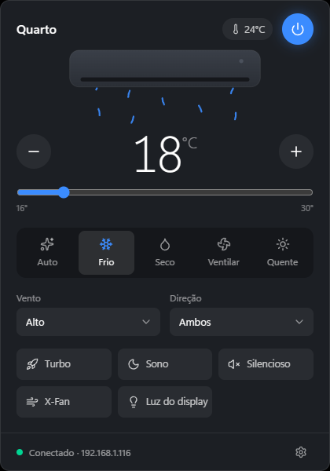

# Ar Condicionado

App de bandeja pro Windows que controla ar-condicionado Gree direto pela rede local. Sem nuvem, sem conta e sem o app da Gree no meio: o PC conversa por UDP com o módulo Wi-Fi do aparelho.



## O que faz

- Fica na bandeja do Windows. Clique esquerdo abre o painel, clique direito tem ligar/desligar, procurar aparelhos, iniciar com o Windows e sair.
- Controla tudo do dia a dia: liga/desliga, temperatura (16 a 30 °C), modo (auto, frio, seco, ventilar, quente), velocidade do vento, oscilação vertical/horizontal, turbo, sono, silencioso, X-Fan e luz do display.
- Mostra a temperatura ambiente lida pelo sensor do próprio aparelho.
- O tooltip do ícone mostra o estado atual, tipo `18°C · Frio` ou `Desligado`.
- Lê o estado a cada 5 s com o painel aberto e a cada 60 s fechado, então o que você mudar no controle remoto aparece no app.
- A interface responde na hora e desfaz a mudança se o aparelho não confirmar.
- Se o roteador trocar o IP do aparelho, o app acha ele de novo pelo MAC.

## Como funciona

O módulo Wi-Fi da Gree (usado também por algumas outras marcas) escuta comandos em JSON na porta UDP 7000:

1. **Busca**: broadcast de `{"t":"scan"}` na rede. Cada aparelho responde com nome, MAC e firmware, criptografado com uma chave genérica.
2. **Pareamento**: o app manda um `bind` com a chave genérica e recebe a chave própria do aparelho.
3. **Uso**: `status` pra ler e `cmd` pra mudar, tudo criptografado com a chave do aparelho.

Existem duas versões de criptografia: AES-128-ECB (firmwares antigos) e AES-128-GCM (novos). O app tenta as duas e guarda a que funcionou. Tem aparelho que responde a busca numa e o pareamento na outra, então isso é testado nas duas etapas.

IP, MAC, chave e versão ficam salvos em `%APPDATA%\com.local.arcondicionado\config.json`.

## Stack

- **Tauri 2**: back em Rust (protocolo, bandeja, polling, config) e front no WebView2
- **React + TypeScript + Tailwind** na interface
- **tokio, aes, aes-gcm, base64, serde_json** no protocolo

## Rodando

Precisa de Windows 10/11, Node 20+ e Rust stable (MSVC).

```sh
npm install
npm run tauri dev
```

Pra gerar o instalador:

```sh
npm run dist
```

Sai em `src-tauri/target/release/bundle/nsis/`.

Na primeira vez o app abre a tela de busca: escolhe o aparelho e pronto. PC e ar-condicionado precisam estar na mesma rede, e o firewall do Windows pode pedir permissão.

## Testando sem a interface

```sh
cd src-tauri
cargo run --example gree_debug          # busca, pareia e imprime o status em JSON
cargo run --example gree_debug <mac>    # um aparelho específico
cargo test                              # criptografia e offset do sensor
```

O debug só lê, não manda comando nenhum pro aparelho.

## Estrutura

```
src-tauri/src/
  gree/crypto.rs       ECB e GCM
  gree/discovery.rs    busca por broadcast
  gree/device.rs       bind, status, cmd, retries, offset do sensor
  commands.rs          comandos chamados pela interface e polling
  tray.rs              ícone, menu e posição do painel
  config.rs            config no AppData
src/
  hooks/useAcState.ts  estado, atualização otimista e debounce
  lib/mappings.ts      valores da interface <-> protocolo
  components/          telas e controles
```

## Créditos

O protocolo foi implementado em cima do que já foi mapeado por [greeclimate](https://github.com/cmroche/greeclimate) e [gree-remote](https://github.com/tomikaa87/gree-remote).
